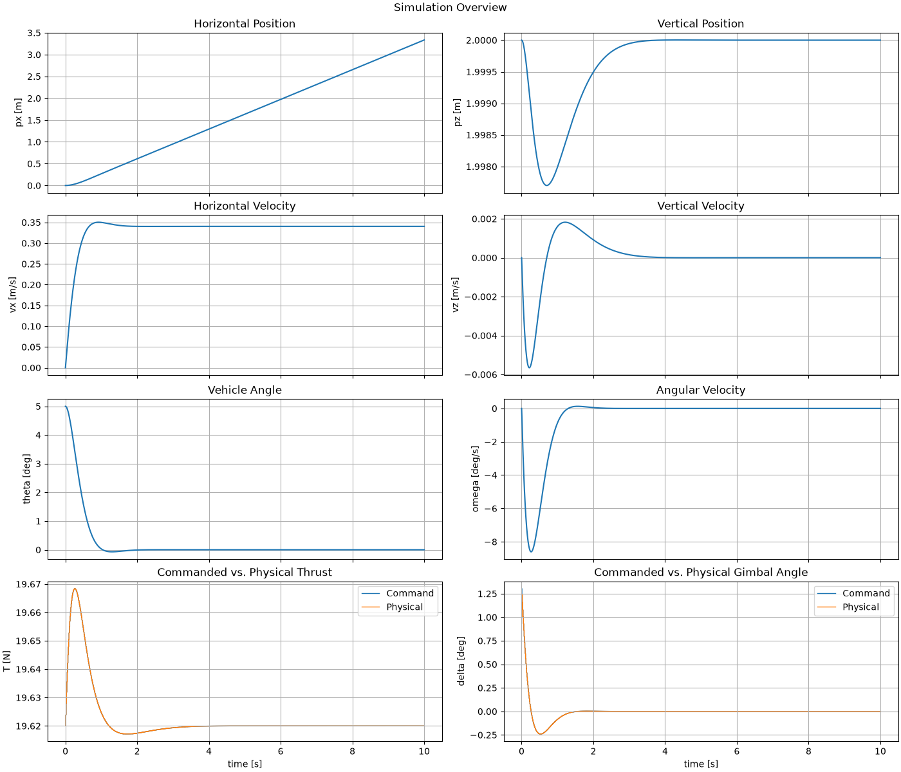

# Attitude- und Altitude-Stabilisierung

## Zweck

Dieses Beispiel untersucht den kombinierten Einsatz der ersten beiden geschlossenen Regelkreise des Fast Simulators:

- Lageregelung,
- Höhenregelung.

Der Versuch baut auf der bereits validierten Plant mit Aktuatormodellen auf und ergänzt zwei unabhängige PD-Regler.

Der vollständige Datenfluss lautet:

```text
AttitudeReference2D
        +
HopperState2D
        │
        ▼
PDAttitudeController2D
        │
        ▼
delta_cmd
        │
        │
        ├────────────────────┐
                             │
AltitudeReference2D          │
        +                    │
HopperState2D                │
        │                    │
        ▼                    │
PDAltitudeController2D       │
        │                    │
        ▼                    │
thrust_cmd                   │
        │                    │
        └──────────┬─────────┘
                   ▼
      HopperActuationCommand2D
                   │
                   ▼
          SimulationRunner
                   │
                   ▼
            HopperSystem2D
                   │
                   ├── Aktuatormodelle
                   │
                   ▼
          HopperActuation2D
                   │
                   ▼
           HopperSimulator
                   │
                   ▼
           Hopper2DDynamics
```

Der Versuch soll zeigen, dass sich Lage und Höhe gleichzeitig stabilisieren lassen, obwohl der horizontale Freiheitsgrad weiterhin ungeregelt bleibt.

> **Hinweis zur Reproduzierbarkeit:**  
> Die Beispielseite beschreibt die Konfiguration von `attitude_altitude_stabilization.py`. Änderungen an Modellparametern, Reglerparametern, Aktuatorgrenzen oder numerischer Integration können zu anderen Ergebnissen führen. Nach solchen Änderungen müssen erzeugte Abbildungen und deren Interpretation gemeinsam aktualisiert werden.

---

## Konfiguration

### Starrkörperparameter

Für den Versuch werden dieselben frei gewählten Beispielparameter wie in den vorherigen Fast-Sim-Versuchen verwendet:

\[
m=2.0\,\mathrm{kg}
\]

\[
I_y=0.08\,\mathrm{kg\,m^2}
\]

\[
l=0.25\,\mathrm m
\]

\[
g=9.81\,\mathrm{m/s^2}.
\]

Daraus ergibt sich der nominale Hover-Schub:

\[
T_{\mathrm{hover}}
=
mg
=
19.62\,\mathrm N.
\]

Diese Werte repräsentieren weiterhin keine bereits festgelegte reale Hopper-Hardware.

### Anfangszustand

Der Starrkörper startet mit:

\[
p_x=0
\]

\[
p_z=2\,\mathrm m
\]

\[
v_x=0
\]

\[
v_z=0
\]

\[
\theta=5^\circ
\]

\[
\omega=0.
\]

Der Hopper befindet sich damit bereits auf der gewünschten Höhe, besitzt aber eine kleine positive Lageabweichung.

### Referenzen

Die Lagereferenz lautet:

\[
\theta_{\mathrm{ref}}=0
\]

und:

\[
\omega_{\mathrm{ref}}=0.
\]

Die Höhenreferenz lautet:

\[
p_{z,\mathrm{ref}}=2\,\mathrm m
\]

und:

\[
v_{z,\mathrm{ref}}=0.
\]

Damit wird ein aufrechter, höhenkonstanter Zustand gefordert.

---

# Aktuatormodelle

## Schub

Der Schubaktuator verwendet:

\[
T_{\min}=0\,\mathrm N
\]

und:

\[
T_{\max}=30\,\mathrm N.
\]

Der Altitude Controller darf einen größeren Command anfordern.

Die physikalische Begrenzung erfolgt ausschließlich im Aktuatormodell.

## Gimbal

Der Gimbal verwendet:

\[
\delta_{\max}=10^\circ
\]

und:

\[
\dot\delta_{\max}=100^\circ/\mathrm s.
\]

Der interne Gimbalzustand startet bei:

\[
\delta_0=0^\circ.
\]

Damit kann ein sprunghafter Gimbal-Command nicht sofort physikalisch erreicht werden.

---

# Lageregler

Die Lageregelung verwendet einen PD-Regler.

Der Lagefehler lautet:

\[
e_\theta
=
\operatorname{wrapToPi}
\left(
\theta-\theta_{\mathrm{ref}}
\right).
\]

Der Winkelgeschwindigkeitsfehler lautet:

\[
e_\omega
=
\omega-\omega_{\mathrm{ref}}.
\]

Der Gimbal-Command ergibt sich aus:

\[
\delta_{\mathrm{cmd}}
=
K_{P,\theta}e_\theta
+
K_{D,\theta}e_\omega.
\]

Die Gains werden über einen gewünschten lokalen Arbeitspunkt ausgelegt.

Für den Versuch werden verwendet:

\[
\omega_{n,\theta}=4\,\mathrm{rad/s}
\]

und:

\[
\zeta_\theta=0.8.
\]

Mit den verwendeten Modellparametern und:

\[
T_{\mathrm{nom}}=19.62\,\mathrm N
\]

ergeben sich ungefähr:

\[
K_{P,\theta}\approx0.261
\]

und:

\[
K_{D,\theta}\approx0.104\,\mathrm s.
\]

---

# Höhenregler

Die Höhenregelung verwendet ebenfalls einen PD-Regler.

Der Höhenfehler wird definiert als:

\[
e_z
=
p_{z,\mathrm{ref}}-p_z.
\]

Der Vertikalgeschwindigkeitsfehler lautet:

\[
e_{v_z}
=
v_{z,\mathrm{ref}}-v_z.
\]

Der rohe Schub-Command lautet:

\[
T_{\mathrm{cmd,raw}}
=
T_{\mathrm{hover}}
+
K_{P,z}e_z
+
K_{D,z}e_{v_z}.
\]

Mit:

\[
T_{\mathrm{hover}}=mg
\]

muss der PD-Anteil nur Abweichungen vom stationären Hoverzustand korrigieren.

Für die Auslegung werden verwendet:

\[
\omega_{n,z}=2\,\mathrm{rad/s}
\]

und:

\[
\zeta_z=0.9.
\]

Daraus folgen:

\[
K_{P,z}
=
m\omega_{n,z}^2
=
8\,\mathrm{N/m}
\]

und:

\[
K_{D,z}
=
2\zeta_z\omega_{n,z}m
=
7.2\,\mathrm{N/(m/s)}.
\]

Der Regler begrenzt nur negative Rohwerte auf:

\[
T_{\mathrm{cmd}}=0.
\]

Eine obere physikalische Schubgrenze bleibt Verantwortung des Aktuatormodells.

---

# Numerische Simulation

Die Simulation läuft über:

\[
5\,\mathrm s
\]

mit einer Systemschrittweite von:

\[
\Delta t=0.01\,\mathrm s.
\]

Damit werden:

\[
N=500
\]

Systemschritte ausgeführt.

Für die Starrkörperintegration wird `RK4Integrator` verwendet.

---

# Erwarteter Ablauf

## 1. Beginn der Lagekorrektur

Zu Beginn gilt:

\[
\theta=5^\circ
\]

bei:

\[
\theta_{\mathrm{ref}}=0.
\]

Der Attitude Controller fordert daher einen positiven Gimbalwinkel an.

Nach der im Fast Simulator verwendeten Vorzeichenkonvention gilt:

\[
\delta>0
\quad\Rightarrow\quad
\dot\omega<0.
\]

Der Hopper beginnt sich damit zurück in Richtung der aufrechten Soll-Lage zu drehen.

## 2. Einfluss auf die Vertikalbewegung

Während der Lagekorrektur ist der physikalische Schubvektor zeitweise geneigt.

Die vertikale Beschleunigung lautet:

\[
\dot v_z
=
\frac{T}{m}
\cos(\theta+\delta)
-g.
\]

Auch bei:

\[
T=mg
\]

ist die vertikale Schubkomponente daher kleiner als die Gewichtskraft, solange:

\[
\theta+\delta\neq0.
\]

Dadurch kann zunächst eine kleine negative Vertikalgeschwindigkeit entstehen.

## 3. Reaktion der Höhenregelung

Sobald:

\[
p_z<p_{z,\mathrm{ref}}
\]

oder:

\[
v_z<0
\]

gilt, werden:

\[
e_z>0
\]

beziehungsweise:

\[
e_{v_z}>0.
\]

Der Altitude Controller erhöht dann den angeforderten Schub über den nominalen Hoverwert:

\[
T_{\mathrm{cmd}}>mg.
\]

Damit wird die Sinkbewegung abgebremst und der Höhenfehler wieder reduziert.

## 4. Stationärer Zielzustand

Nach erfolgreicher Stabilisierung soll näherungsweise gelten:

\[
\theta\rightarrow0,
\]

\[
\omega\rightarrow0,
\]

\[
p_z\rightarrow2\,\mathrm m,
\]

\[
v_z\rightarrow0.
\]

Im idealen stationären Fall nähern sich die Commands wieder:

\[
\delta_{\mathrm{cmd}}\rightarrow0
\]

und:

\[
T_{\mathrm{cmd}}\rightarrow mg.
\]

---

# Simulationsübersicht

Für den Versuch wird `plot_simulation_overview(result)` verwendet.

Die Übersicht enthält acht Subplots:

```text
┌─────────────────────┬─────────────────────┐
│ Horizontal Position │ Vertical Position   │
├─────────────────────┼─────────────────────┤
│ Horizontal Velocity │ Vertical Velocity   │
├─────────────────────┼─────────────────────┤
│ Vehicle Angle       │ Angular Velocity    │
├─────────────────────┼─────────────────────┤
│ Thrust Cmd/Physical │ Gimbal Cmd/Physical │
└─────────────────────┴─────────────────────┘
```

Für die Dokumentation sollte die erzeugte Übersicht unter folgendem Pfad gespeichert werden:

```text
docs/assets/fast_sim/examples/attitude_altitude_stabilization/
└── simulation_overview.png
```

Nach dem Erzeugen kann sie hier eingebunden werden:



---

# Auswertungskriterien

Der Versuch gilt als erfolgreich, wenn die Simulation qualitativ und quantitativ die vorgesehenen Regelwirkungen zeigt.

## Lageregelung

Erwartet wird:

\[
\theta\rightarrow0
\]

und:

\[
\omega\rightarrow0.
\]

Der Gimbal-Command soll zunächst das zur Lagekorrektur notwendige Vorzeichen besitzen und anschließend wieder gegen null gehen.

## Höhenregelung

Erwartet wird:

\[
p_z\rightarrow p_{z,\mathrm{ref}}
\]

und:

\[
v_z\rightarrow0.
\]

Während der Lagekorrektur darf die Höhe kurzfristig von der Referenz abweichen.

Der Altitude Controller soll den daraus entstehenden Fehler anschließend abbauen.

## Command und physikalische Actuation

Im Overview-Plot sollen Command und physikalische Actuation getrennt erkennbar sein.

Beim Gimbal können insbesondere:

- Winkelbegrenzung,
- Ratenbegrenzung

zu Abweichungen zwischen:

\[
\delta_{\mathrm{cmd}}
\]

und:

\[
\delta
\]

führen.

Beim Schub kann eine Abweichung zwischen:

\[
T_{\mathrm{cmd}}
\]

und:

\[
T
\]

auftreten, wenn die maximale Schubgrenze erreicht wird.

---

# Horizontaler Drift

Die horizontale Position ist in diesem Versuch weiterhin nicht geregelt.

Während der Lagekorrektur entsteht eine horizontale Schubkomponente:

\[
\dot v_x
=
\frac{T}{m}
\sin(\theta+\delta).
\]

Dadurch kann eine horizontale Geschwindigkeit aufgebaut werden.

Selbst wenn später:

\[
\theta=0
\]

und:

\[
\delta=0
\]

erreicht sind, bedeutet:

\[
\dot v_x=0
\]

nur, dass die bereits vorhandene horizontale Geschwindigkeit konstant bleibt.

Es kann daher weiterhin gelten:

\[
v_x\neq0
\]

und entsprechend:

\[
p_x
\]

weiter driften.

Dieses Verhalten ist im aktuellen Entwicklungsstand erwartet.

Der Versuch soll daher ausdrücklich nicht zeigen, dass der Hopper bereits seine vollständige Position hält.

---

# Bedeutung des Versuchs

Der kombinierte Closed-Loop-Versuch ist ein wichtiger Zwischenschritt.

Er zeigt erstmals, dass zwei getrennte Regler gleichzeitig Commands für dasselbe physische Hopper-System erzeugen können:

```text
Attitude Controller
        +
Altitude Controller
        ↓
HopperActuationCommand2D
        ↓
HopperSystem2D
```

Gleichzeitig bleibt sichtbar, dass die physikalischen Freiheitsgrade gekoppelt sind.

Die Lageregelung beeinflusst über die Schubrichtung die Vertikalbewegung.

Die Höhenregelung verändert über den Schub gleichzeitig die verfügbare Rotationsautorität des Gimbals.

Die Regler sind softwareseitig getrennt, wirken aber auf dieselbe gekoppelte Plant.

---

# Nächster offener Freiheitsgrad

Nach erfolgreicher Lageregelung und Höhenregelung bleibt die horizontale Bewegung offen:

\[
p_x,\quad v_x.
\]

Ein späterer Horizontal Position Controller kann diesen Freiheitsgrad schließen.

Da keine unabhängige horizontale Kraftquelle existiert, wird dieser Regler voraussichtlich eine gewünschte Fahrzeuglage erzeugen:

```text
px_ref, vx_ref
       ↓
Horizontal Position Controller
       ↓
theta_ref
       ↓
Attitude Controller
       ↓
delta_cmd
```

Damit entsteht eine kaskadierte Regelungsarchitektur.

---

# Fazit

Das Beispiel dient als erster kombinierter Closed-Loop-Test von Lage- und Höhenregelung.

Es überprüft insbesondere:

- die parallele Verwendung zweier unabhängiger Controller,
- die Zusammensetzung von `thrust_cmd` und `delta_cmd`,
- die Stabilisierung von \(\theta\) und \(\omega\),
- die Stabilisierung von \(p_z\) und \(v_z\),
- den Hover-Feedforward der Höhenregelung,
- die Wirkung der physikalischen Aktuatorgrenzen,
- die Kopplung zwischen Lage- und Vertikaldynamik,
- die weiterhin offene horizontale Bewegung.

Die tatsächlich gemessenen Endwerte und die Interpretation des Overview-Plots sollten nach Ausführung des Beispiels ergänzt beziehungsweise überprüft werden.
