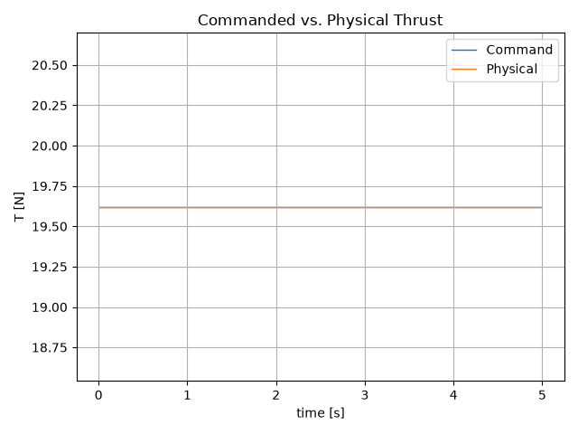
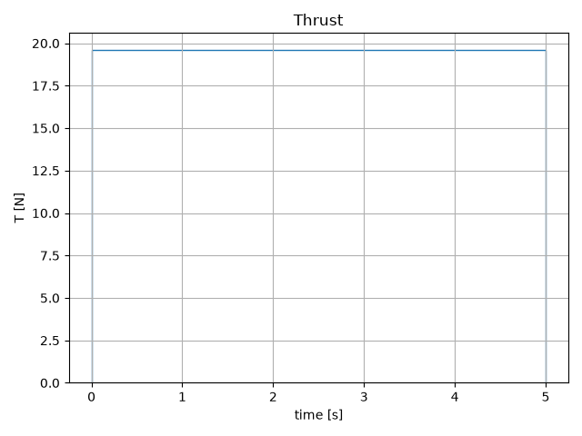
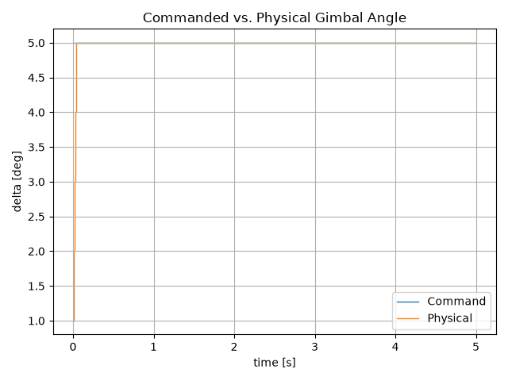
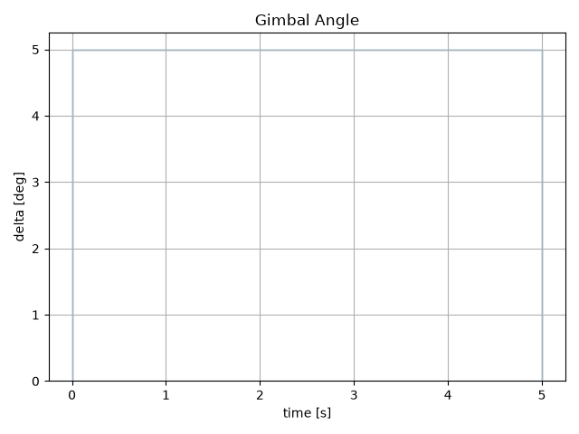
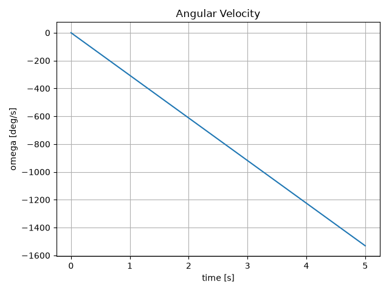
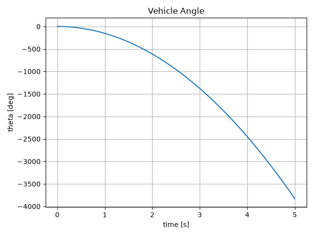
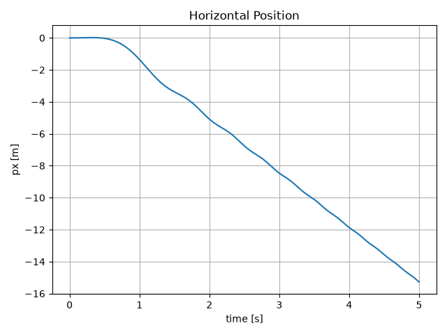
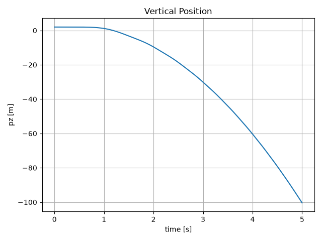

# Open-Loop-Beispiel mit konstantem Gimbal-Command

## Zweck

Dieses Beispiel dient der qualitativen Validierung des vollständigen Simulationspfads des Fast Simulators einschließlich der ersten Aktuatormodelle.

Es werden dabei mehrere Komponenten gemeinsam verwendet:

```text
CommandProvider
        ↓
SimulationRunner
        ↓
HopperSystem2D
        ↓
HopperActuatorSystem2D
        ↓
HopperActuation2D
        ↓
HopperSimulator
        ↓
RK4Integrator
        ↓
Hopper2DDynamics
        ↓
SimulationResult
        ↓
Visualisierung
```

Der Versuch verwendet bewusst noch keinen Controller.

Stattdessen wird während des vollständigen Laufs ein konstanter `HopperActuationCommand2D` vorgegeben.

Die Aktuatormodelle übersetzen diesen Command in die tatsächlich auf den Starrkörper wirkende `HopperActuation2D`.

Das Beispiel stellt daher keinen sinnvollen Flugzustand dar, sondern einen einfachen Open-Loop-Test, mit dem sowohl das Dynamikmodell als auch die Wirkung der Aktuatorgrenzen nachvollzogen werden können.

> **Hinweis zur Reproduzierbarkeit:**  
> Die dargestellten Plots müssen mit der auf dieser Seite beschriebenen Simulationskonfiguration erzeugt werden. Änderungen am Dynamikmodell, Integrator, Aktuatormodell oder an den Beispielparametern können zu anderen Ergebnissen führen. In diesem Fall müssen Abbildungen und Interpretation gemeinsam aktualisiert werden.

---

## Konfiguration

### Starrkörperparameter

Für das Beispiel werden folgende frei gewählte Modellparameter verwendet:

\[
m = 2.0\,\mathrm{kg}
\]

\[
I_y = 0.08\,\mathrm{kg\,m^2}
\]

\[
l = 0.25\,\mathrm{m}
\]

Diese Werte dienen ausschließlich als Beispielparameter und repräsentieren keine bereits festgelegte Hopper-Hardware.

Die Gravitationsbeschleunigung beträgt:

\[
g = 9.81\,\mathrm{m/s^2}.
\]

### Anfangszustand

Der Starrkörper startet mit:

\[
p_x = 0
\]

\[
p_z = 2\,\mathrm{m}
\]

\[
v_x = 0
\]

\[
v_z = 0
\]

\[
\theta = 0
\]

\[
\omega = 0.
\]

### Command

Während des vollständigen Laufs wird konstant angefordert:

\[
T_{\mathrm{cmd}} = mg = 19.62\,\mathrm{N}
\]

und:

\[
\delta_{\mathrm{cmd}} = +5^\circ.
\]

### Schubaktuator

Der vereinfachte Schubaktuator verwendet:

\[
T_{\min}=0\,\mathrm{N}
\]

und:

\[
T_{\max}=30\,\mathrm{N}.
\]

Da der angeforderte Schub innerhalb dieser Grenzen liegt, wird der Schub-Command im betrachteten Versuch nicht begrenzt.

### Gimbalaktuator

Der Gimbal verwendet:

\[
\delta_{\max}=10^\circ
\]

und:

\[
\dot\delta_{\max}=100^\circ/\mathrm{s}.
\]

Der interne Gimbalzustand startet bei:

\[
\delta_0=0^\circ.
\]

### Numerische Simulation

Die Simulation läuft über:

\[
5\,\mathrm{s}
\]

mit:

\[
\Delta t=0.01\,\mathrm{s}.
\]

Damit werden:

\[
N=500
\]

Systemschritte ausgeführt.

Als Integrator wird `RK4Integrator` verwendet.

---

# Command und tatsächlich wirkende Actuation

Mit der Einführung der Aktuatormodelle muss zwischen angeforderter und tatsächlich wirkender Actuation unterschieden werden.

## Schub

Der Open-Loop-Versuch fordert konstant:

\[
T_{\mathrm{cmd}}=19.62\,\mathrm{N}.
\]

Da dieser Wert innerhalb der konfigurierten Schubgrenzen liegt, gilt während des vollständigen Laufs:

\[
T=T_{\mathrm{cmd}}=19.62\,\mathrm{N}.
\]



Die beiden Verläufe liegen daher übereinander.

Dies bestätigt, dass das aktuelle Schubaktuatormodell einen zulässigen Command unverändert weitergibt.

Der physikalische Schub allein kann weiterhin als Basisplot dargestellt werden:



## Gimbalwinkel

Der angeforderte Gimbalwinkel liegt ab Beginn des Versuchs konstant bei:

\[
\delta_{\mathrm{cmd}}=5^\circ.
\]

Der physikalische Gimbal startet dagegen bei:

\[
\delta_0=0^\circ
\]

und besitzt eine maximale Gimbalrate von:

\[
\dot\delta_{\max}=100^\circ/\mathrm{s}.
\]

Bei:

\[
\Delta t=0.01\,\mathrm{s}
\]

beträgt die maximal mögliche Winkeländerung pro Systemschritt:

\[
\Delta\delta_{\max}
=
100^\circ/\mathrm{s}
\cdot
0.01\,\mathrm{s}
=
1^\circ.
\]

Mit der aktuellen diskreten Aktuatorsemantik ergibt sich zu Beginn:

| Systemschritt | Command | physikalischer Gimbalwinkel |
|---:|---:|---:|
| 0 | \(5^\circ\) | \(1^\circ\) |
| 1 | \(5^\circ\) | \(2^\circ\) |
| 2 | \(5^\circ\) | \(3^\circ\) |
| 3 | \(5^\circ\) | \(4^\circ\) |
| 4 | \(5^\circ\) | \(5^\circ\) |
| ab 5 | \(5^\circ\) | \(5^\circ\) |



Der Vergleichsplot zeigt damit erstmals unmittelbar die Wirkung eines zustandsbehafteten Aktuatormodells.

Der physikalische Gimbalwinkel folgt dem sprunghaften Command nur mit der zulässigen Änderungsrate.

Der Basisplot zeigt ausschließlich den tatsächlich wirkenden Gimbalwinkel:



> **Hinweis zur Zeitzuordnung:**  
> `physical_actuations[0]` enthält bereits den für das erste Starrkörperintervall berechneten Gimbalwinkel von \(1^\circ\). Der interne Anfangswert \(0^\circ\) ist kein eigener Eintrag in der `physical_actuations`-Historie.

---

# Rotationsverhalten

## Winkelbeschleunigung

Die Rotationsdynamik lautet:

\[
\dot\omega
=
-\frac{lT}{I_y}\sin\delta.
\]

Anders als im früheren idealisierten Beispiel ist der physikalische Gimbalwinkel während der ersten Systemschritte nicht sofort konstant.

Daher ist auch die Winkelbeschleunigung während dieser kurzen Anfahrphase zunächst nicht konstant.

Für die ersten Schritte wird nacheinander ungefähr mit

\[
\delta =
1^\circ,\,
2^\circ,\,
3^\circ,\,
4^\circ,\,
5^\circ
\]

integriert.

Sobald der physikalische Gimbal den Command erreicht hat, gilt dauerhaft:

\[
\delta=5^\circ.
\]

Ab diesem Zeitpunkt ist die Winkelbeschleunigung bei konstantem Schub ebenfalls konstant:

\[
\dot\omega
=
-\frac{
0.25\cdot19.62
}{
0.08
}
\sin(5^\circ)
\approx
-5.34\,\mathrm{rad/s^2}.
\]

Dies entspricht ungefähr:

\[
\dot\omega
\approx
-306^\circ/\mathrm{s^2}.
\]

## Winkelgeschwindigkeit

Während der kurzen Gimbal-Anfahrphase besitzt die Winkelgeschwindigkeit zunächst eine leicht veränderliche Steigung.

Nach Erreichen von \(5^\circ\) wird der Verlauf praktisch linear, da anschließend ein konstantes Drehmoment wirkt.



Für die aktuelle Konfiguration liegt die Winkelgeschwindigkeit nach fünf Sekunden ungefähr bei:

\[
\omega(5)
\approx
-1525^\circ/\mathrm{s}.
\]

Das negative Vorzeichen bestätigt weiterhin die definierte Gimbalkonvention:

\[
\delta>0
\quad\Rightarrow\quad
\dot\omega<0.
\]

Damit werden sowohl das Vorzeichen des Gimbalmoments als auch die Wirkung der Gimbalratenbegrenzung im vollständigen Simulationspfad sichtbar.

---

## Fahrzeugwinkel

Die Fahrzeugorientierung ergibt sich weiterhin aus:

\[
\dot\theta=\omega.
\]

Da die Winkelbeschleunigung nur während der sehr kurzen Gimbal-Anfahrphase variiert und anschließend konstant ist, entwickelt sich der Fahrzeugwinkel nach dieser Anfangsphase näherungsweise quadratisch.



Für die aktuelle Konfiguration liegt der Winkel nach fünf Sekunden ungefähr bei:

\[
\theta(5)
\approx
-3797^\circ.
\]

Der große negative Winkel bedeutet, dass sich der Hopper während des unkontrollierten Open-Loop-Laufs mehrfach vollständig gedreht hat.

Der Winkel \(\theta\) wird im Dynamikmodell bewusst nicht auf einen Bereich wie

\[
[-180^\circ,180^\circ)
\]

beschränkt.

Dadurch bleibt die Orientierung während der numerischen Integration kontinuierlich und enthält keine künstlichen Sprünge an einer Winkelgrenze.

---

# Translationsverhalten

Die Translation hängt von der Richtung des tatsächlich wirkenden Schubvektors gegenüber dem World Frame ab.

Diese wird bestimmt durch:

\[
\theta+\delta.
\]

Dabei ist \(\delta\) ausdrücklich der **physikalische Gimbalwinkel** und nicht der angeforderte Command.

Die Beschleunigungen lauten:

\[
\dot v_x
=
\frac{T}{m}
\sin(\theta+\delta)
\]

und:

\[
\dot v_z
=
\frac{T}{m}
\cos(\theta+\delta)
-g.
\]

Da sich sowohl \(\theta\) als auch während der ersten Schritte \(\delta\) verändern, ändern sich die horizontalen und vertikalen Komponenten des Schubvektors fortlaufend.

---

## Horizontale Position

Im ersten Systemschritt wirkt noch nicht der vollständige Gimbal-Command von \(5^\circ\), sondern zunächst:

\[
\delta=1^\circ.
\]

Die anfängliche horizontale Beschleunigung ist damit positiv:

\[
\dot v_x
=
\frac{T}{m}\sin(1^\circ)
>0.
\]

Mit jedem der ersten Schritte wächst der physikalische Gimbalwinkel, bis \(5^\circ\) erreicht sind.

Gleichzeitig beginnt der Hopper aufgrund des negativen Gimbalmoments in negativer \(\theta\)-Richtung zu rotieren.

Sobald:

\[
\theta+\delta<0
\]

gilt, wird auch die horizontale Schubkomponente negativ.



Der Positionsverlauf ist daher weder allein aus dem Vorzeichen des Commands noch allein aus dem momentanen Gimbalwinkel ableitbar.

Entscheidend ist jederzeit:

\[
\theta+\delta.
\]

Für die aktuelle Konfiguration liegt die horizontale Position nach fünf Sekunden ungefähr bei:

\[
p_x(5)
\approx
-15.2\,\mathrm{m}.
\]

---

## Vertikale Position

Zu Beginn ist der Schub nahezu vertikal nach oben gerichtet.

Da der physikalische Gimbal zunächst nur kleine Winkel erreicht, ist die vertikale Schubkomponente zu Beginn fast so groß wie der Gesamtschub.

Mit:

\[
T=mg
\]

ist die vertikale Beschleunigung anfangs daher nur geringfügig negativ.

Durch die fortlaufende Rotation des Hoppers verändert sich die vertikale Komponente des Schubs anschließend stark.



Die vertikale Beschleunigung lautet:

\[
\dot v_z
=
\frac{T}{m}\cos(\theta+\delta)-g.
\]

Zeigt der Schub horizontal, gilt:

\[
\cos(\theta+\delta)=0
\]

und damit:

\[
\dot v_z=-g.
\]

Zeigt der Schub teilweise nach unten, gilt:

\[
\cos(\theta+\delta)<0.
\]

In diesem Fall wirken Schub und Gravitation gemeinsam in negativer \(z\)-Richtung.

Bei vollständig nach unten gerichtetem Schub und:

\[
T=mg
\]

würde beispielsweise gelten:

\[
\dot v_z=-2g.
\]

Für die aktuelle Konfiguration liegt die vertikale Position nach fünf Sekunden ungefähr bei:

\[
p_z(5)
\approx
-99.5\,\mathrm{m}.
\]

Der starke Höhenverlust ist damit weiterhin eine erwartete Folge der unkontrollierten Rotation.

---

# Bedeutung negativer Höhenwerte

Im Verlauf erreicht der Simulator Werte mit:

\[
p_z<0.
\]

Dies ist im aktuellen Modell zulässig.

Der Fast Simulator besitzt momentan noch keine:

- Bodeninteraktion,
- Kollisionserkennung,
- Landebeinkontakte,
- Touchdown-Logik,
- Abbruchbedingung bei Bodenkontakt.

Das Dynamikmodell integriert deshalb die freie Starrkörperbewegung auch unterhalb des gewählten Höhenursprungs weiter.

Negative Höhenwerte dürfen daher in diesem Experiment nicht als physikalische Bewegung eines realen Fahrzeugs durch den Boden interpretiert werden.

Sie zeigen lediglich, wie sich die freie Dynamik ohne Bodenmodell fortsetzen würde.

---

# Warum das Verhalten stark divergiert

Das sehr schnelle Rotieren und der starke Höhenverlust sind kein Hinweis auf einen Fehler des Simulators.

Im Experiment wird für volle fünf Sekunden ein konstanter positiver Gimbal-Command angefordert.

Das Gimbalaktuatormodell begrenzt zwar die anfängliche Winkeländerung, erreicht nach wenigen Schritten jedoch den gewünschten Winkel von:

\[
5^\circ.
\]

Ab diesem Zeitpunkt wirkt dauerhaft ein nahezu konstantes negatives Drehmoment auf den freien Starrkörper.

Gleichzeitig fehlen bewusst noch mehrere reale Effekte und Regelmechanismen.

Insbesondere existieren noch keine:

- Lageregelung,
- Positionsregelung,
- aerodynamische Dämpfung,
- Bodeninteraktion.

Die Gimbalratenbegrenzung verhindert lediglich einen instantanen Winkelsprung. Sie stabilisiert das Fahrzeug nicht.

Die stetig zunehmende Winkelgeschwindigkeit ist daher weiterhin eine direkte Konsequenz des aktuellen Newton-Euler-Modells unter einem dauerhaften Gimbalmoment.

---

# Bewertung des Versuchs

Der Open-Loop-Lauf bestätigt mehrere zentrale Eigenschaften des aktuellen Fast Simulators.

### Aktuatormodelle

Der Schub-Command liegt innerhalb der zulässigen Schubgrenzen und wird daher unverändert als physikalischer Schub übernommen.

Der Gimbal-Command kann dagegen aufgrund der maximalen Gimbalrate nicht sofort erreicht werden.

Die Vergleichsplots machen damit erstmals direkt sichtbar:

\[
u_{\mathrm{cmd}}
\neq
u_{\mathrm{physical}}
\]

wenn ein Aktuatormodell eine physikalische Begrenzung erzwingt.

### Rotationsdynamik

Ein positiver physikalischer Gimbalwinkel erzeugt das erwartete negative Drehmoment:

\[
\delta>0
\quad\Rightarrow\quad
\dot\omega<0.
\]

Während der kurzen Gimbal-Anfahrphase wächst die Winkelbeschleunigung mit dem physikalischen Gimbalwinkel.

Nach Erreichen des Commands wirkt bei konstantem Schub und konstantem Gimbalwinkel eine konstante Winkelbeschleunigung.

### Translationsdynamik

Die Translation hängt korrekt von der Orientierung des tatsächlich wirkenden Schubvektors im World Frame ab:

\[
\theta+\delta.
\]

Die fortlaufende Rotation des Hoppers verändert daher sowohl die horizontale als auch die vertikale Schubkomponente.

Die daraus resultierenden Positionsverläufe sind qualitativ plausibel.

### Vollständiger Datenfluss

Der Versuch prüft nun den vollständigen Pfad:

```text
Command
   ↓
Aktuatormodell
   ↓
physikalische Actuation
   ↓
Starrkörperdynamik
   ↓
SimulationResult
   ↓
Visualisierung
```

Damit wird nicht mehr nur die Starrkörperdynamik, sondern erstmals auch die Command-zu-Actuation-Grenze end-to-end sichtbar.

---

# Fazit

Das Experiment dient als mehrsekündiger End-to-End-Plausibilitätstest des Fast Simulators einschließlich der ersten Aktuatormodelle.

Es bestätigt insbesondere:

- die Trennung zwischen Command und physikalischer Actuation,
- die Schubsättigungslogik für einen Command innerhalb der Grenzen,
- die Gimbalratenbegrenzung,
- die Vorzeichenkonvention des Gimbalmoments,
- die Größenordnung der Rotationsdynamik,
- die kontinuierliche Integration des Fahrzeugwinkels,
- die Kopplung zwischen Rotation und Translation,
- die korrekte Aufzeichnung von Commands und physikalischer Actuation,
- die Funktion der vollständigen Simulationskette bis zur Visualisierung.

Der Versuch stellt bewusst keinen stabilen Flugzustand dar.

Das stark divergierende Verhalten zeigt vielmehr, dass ein physikalisch begrenztes Gimbal allein keine Stabilisierung erzeugt und für einen realen Hopper eine aktive Lageregelung erforderlich ist.
