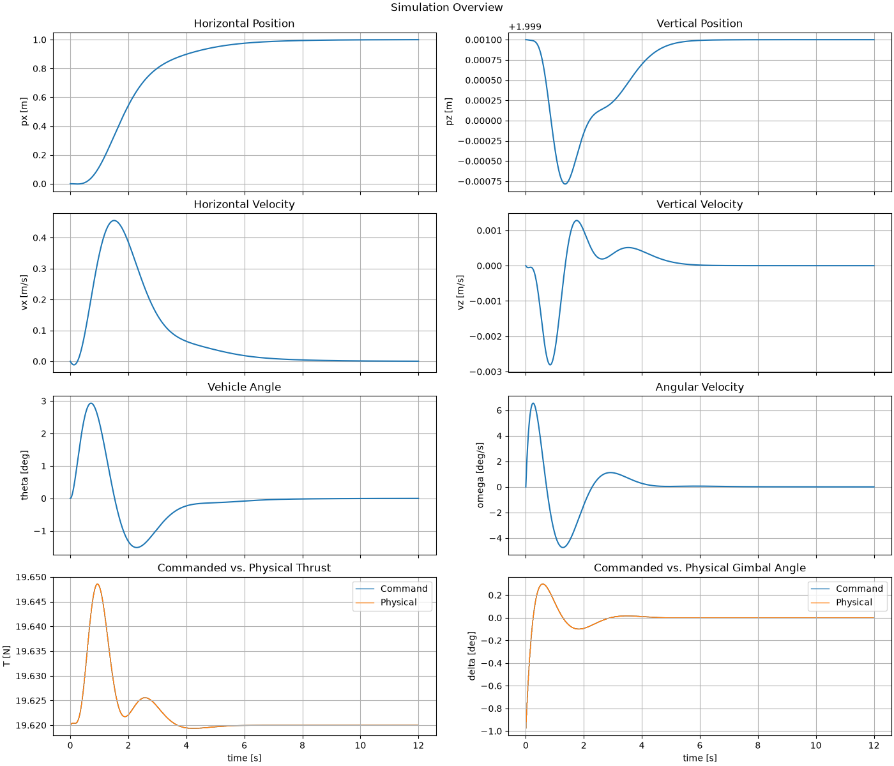

# Horizontale Positionsstabilisierung

## Zweck

Dieses Beispiel ist der erste Versuch, in dem alle aktuell implementierten Regelkreise gemeinsam verwendet werden.

Der Hopper soll:

- eine horizontale Sollposition erreichen,
- seine Höhe halten,
- seine Fahrzeuglage über den inneren Attitude Loop stabilisieren.

Damit entsteht erstmals eine kaskadierte 2D-Positionsregelung.

Der vollständige Regelpfad lautet:

```text
HorizontalPositionReference2D
        +
HopperState2D
        │
        ▼
PDHorizontalPositionController2D
        │
        ▼
AttitudeReference2D
        │
        ▼
PDAttitudeController2D
        │
        ▼
delta_cmd
        │
        │
        ├────────────────────┐
                             │
AltitudeReference2D          │
        +                    │
HopperState2D                │
        │                    │
        ▼                    │
PDAltitudeController2D       │
        │                    │
        ▼                    │
thrust_cmd                   │
        │                    │
        └──────────┬─────────┘
                   ▼
      HopperActuationCommand2D
                   │
                   ▼
          SimulationRunner
                   │
                   ▼
            HopperSystem2D
```

> **Hinweis zur Reproduzierbarkeit:**  
> Die tatsächlich erzeugten Plots müssen mit der auf dieser Seite beschriebenen Konfiguration erzeugt werden. Änderungen an Modell-, Controller- oder Aktuatorparametern können die Ergebnisse verändern. Abbildungen und Interpretation müssen dann gemeinsam aktualisiert werden.

---

## Ziel des Versuchs

Der Hopper startet bei:

\[
p_x=0
\]

und soll eine horizontale Zielposition von:

\[
p_{x,\mathrm{ref}}=1\,\mathrm m
\]

erreichen.

Gleichzeitig soll die Höhe bei:

\[
p_{z,\mathrm{ref}}=2\,\mathrm m
\]

gehalten werden.

Im stationären Zielzustand wird erwartet:

\[
p_x\rightarrow1\,\mathrm m,
\]

\[
v_x\rightarrow0,
\]

\[
p_z\rightarrow2\,\mathrm m,
\]

\[
v_z\rightarrow0,
\]

\[
\theta\rightarrow0,
\]

\[
\omega\rightarrow0.
\]

---

# Modellparameter

Verwendet werden:

\[
m=2.0\,\mathrm{kg}
\]

\[
I_y=0.08\,\mathrm{kg\,m^2}
\]

\[
l=0.25\,\mathrm m
\]

\[
g=9.81\,\mathrm{m/s^2}.
\]

Der nominale Hover-Schub beträgt:

\[
T_{\mathrm{hover}}
=
mg
=
19.62\,\mathrm N.
\]

---

# Anfangszustand

Der Hopper startet aufrecht und ohne Geschwindigkeit:

\[
p_x=0
\]

\[
p_z=2\,\mathrm m
\]

\[
v_x=0
\]

\[
v_z=0
\]

\[
\theta=0
\]

\[
\omega=0.
\]

Im Gegensatz zum vorherigen Attitude-/Altitude-Beispiel wird hier keine anfängliche Lageabweichung vorgegeben.

Die Fahrzeuglage soll vollständig durch den äußeren Horizontal Position Controller angefordert werden.

---

# Referenzen

## Horizontal

Die horizontale Referenz lautet:

\[
p_{x,\mathrm{ref}}=1\,\mathrm m
\]

und:

\[
v_{x,\mathrm{ref}}=0.
\]

## Vertikal

Die Höhenreferenz lautet:

\[
p_{z,\mathrm{ref}}=2\,\mathrm m
\]

und:

\[
v_{z,\mathrm{ref}}=0.
\]

---

# Reglerauslegung

## Attitude Controller

Der Attitude Controller bleibt der schnelle innere Regelkreis.

Verwendet werden:

\[
\omega_{n,\theta}=4\,\mathrm{rad/s}
\]

und:

\[
\zeta_\theta=0.8.
\]

## Altitude Controller

Für die Höhenregelung werden verwendet:

\[
\omega_{n,z}=2\,\mathrm{rad/s}
\]

und:

\[
\zeta_z=0.9.
\]

## Horizontal Position Controller

Der horizontale äußere Regelkreis wird bewusst langsamer ausgelegt:

\[
\omega_{n,x}=0.8\,\mathrm{rad/s}
\]

und:

\[
\zeta_x=0.9.
\]

Damit ergeben sich:

\[
K_{P,x}=0.64\,\mathrm{s^{-2}}
\]

und:

\[
K_{D,x}=1.44\,\mathrm{s^{-1}}.
\]

Die maximale angeforderte Fahrzeuglage wird begrenzt auf:

\[
\theta_{\max}=10^\circ.
\]

Daraus folgt:

\[
a_{x,\max}
=
g\sin(10^\circ)
\approx
1.70\,\mathrm{m/s^2}.
\]

---

# Aktuatormodelle

## Schub

Der Schubaktuator verwendet:

\[
T_{\min}=0\,\mathrm N
\]

und:

\[
T_{\max}=30\,\mathrm N.
\]

## Gimbal

Der Gimbal verwendet:

\[
\delta_{\max}=10^\circ
\]

und:

\[
\dot\delta_{\max}=100^\circ/\mathrm s.
\]

Der Gimbalzustand startet bei:

\[
\delta_0=0^\circ.
\]

---

# Numerische Simulation

Die Simulation läuft über:

\[
8\,\mathrm s
\]

mit:

\[
\Delta t=0.01\,\mathrm s.
\]

Damit werden:

\[
N=800
\]

Systemschritte ausgeführt.

Für die Starrkörperintegration wird `RK4Integrator` verwendet.

---

# Erwarteter Ablauf

## 1. Beschleunigung zur Zielposition

Zu Beginn gilt:

\[
p_x<p_{x,\mathrm{ref}}.
\]

Damit ist:

\[
e_x>0.
\]

Der Horizontal Position Controller fordert eine positive horizontale Beschleunigung an.

Daraus entsteht:

\[
\theta_{\mathrm{ref}}>0.
\]

Der Attitude Controller erzeugt den dafür benötigten Gimbal-Command und kippt den Hopper nach rechts.

Sobald die Fahrzeuglage positiv ist, entsteht eine positive horizontale Schubkomponente.

Der Hopper beschleunigt in Richtung der Zielposition.

## 2. Abbremsen

Mit zunehmender positiver Geschwindigkeit wird der D-Anteil des Horizontal Position Controllers wichtiger.

Vor beziehungsweise beim Erreichen der Zielposition kann eine negative Beschleunigungsanforderung entstehen.

Dann gilt:

\[
\theta_{\mathrm{ref}}<0.
\]

Der Hopper kippt kurz nach links und baut die positive horizontale Geschwindigkeit ab.

Damit soll verhindert werden, dass das Fahrzeug die Zielposition mit hoher Restgeschwindigkeit überschreitet.

## 3. Rückkehr in die aufrechte Lage

Wenn:

\[
p_x\rightarrow p_{x,\mathrm{ref}}
\]

und:

\[
v_x\rightarrow0,
\]

gehen Positions- und Geschwindigkeitsfehler gegen null.

Damit gilt:

\[
a_{x,\mathrm{cmd}}\rightarrow0
\]

und:

\[
\theta_{\mathrm{ref}}\rightarrow0.
\]

Der Attitude Controller stabilisiert den Hopper wieder aufrecht.

## 4. Höhenregelung während des Manövers

Während der horizontalen Beschleunigungs- und Bremsphasen ist der Hopper geneigt.

Dadurch sinkt die vertikale Schubkomponente.

Der Altitude Controller soll auf entstehende Fehler in:

\[
p_z
\]

und:

\[
v_z
\]

reagieren und den Schub entsprechend anpassen.

---

# Simulationsübersicht

Für das Beispiel wird:

```python
plot_simulation_overview(result)
```

verwendet.

Die Übersicht enthält:

```text
┌─────────────────────┬─────────────────────┐
│ Horizontal Position │ Vertical Position   │
├─────────────────────┼─────────────────────┤
│ Horizontal Velocity │ Vertical Velocity   │
├─────────────────────┼─────────────────────┤
│ Vehicle Angle       │ Angular Velocity    │
├─────────────────────┼─────────────────────┤
│ Thrust Cmd/Physical │ Gimbal Cmd/Physical │
└─────────────────────┴─────────────────────┘
```

Für die Dokumentation sollte der Plot unter folgendem Pfad gespeichert werden:

```text
docs/assets/fast_sim/examples/position_stabilization/
└── simulation_overview.png
```

Nach dem Erzeugen kann er hier eingebunden werden:



---

# Auswertungskriterien

## Horizontale Position

Erwartet wird:

\[
p_x\rightarrow1\,\mathrm m.
\]

Die Sollposition sollte mit kleiner verbleibender Abweichung erreicht werden.

## Horizontale Geschwindigkeit

Erwartet wird:

\[
v_x\rightarrow0.
\]

Damit wird geprüft, dass die Zielposition nicht nur passiert, sondern tatsächlich gehalten wird.

## Fahrzeuglage

Während des Manövers darf:

\[
\theta\neq0
\]

sein.

Am Ende wird dagegen erwartet:

\[
\theta\rightarrow0
\]

und:

\[
\omega\rightarrow0.
\]

## Höhe

Die Höhenregelung soll:

\[
p_z\approx2\,\mathrm m
\]

halten und:

\[
v_z\rightarrow0
\]

erreichen.

Kurzzeitige Abweichungen während geneigter Flugphasen sind erwartbar.

## Lagereferenzbegrenzung

Die vom Horizontal Position Controller erzeugte Lagereferenz darf nie größer werden als:

\[
|\theta_{\mathrm{ref}}|
\leq10^\circ.
\]

Die Begrenzung wird über die zugehörige maximale horizontale Beschleunigungsanforderung umgesetzt.

---

# Bedeutung des Versuchs

Dieser Versuch unterscheidet sich grundlegend von den vorherigen Closed-Loop-Beispielen.

Die Lagereferenz ist nicht mehr konstant.

Sie wird dynamisch von einem äußeren Regelkreis erzeugt:

```text
Position Error
        ↓
Horizontal Position Controller
        ↓
Attitude Reference
        ↓
Attitude Controller
```

Damit entsteht erstmals eine echte kaskadierte Flugregelungsstruktur.

Gleichzeitig arbeiten:

- Horizontal Position Controller,
- Attitude Controller,
- Altitude Controller

auf derselben gekoppelten Plant.

---

# Noch nicht modellierte Effekte

Auch bei erfolgreicher Positionsstabilisierung bleibt der Versuch idealisiert.

Nicht enthalten sind unter anderem:

- aerodynamische Kräfte,
- Wind,
- Sensorrauschen,
- Zustandsschätzung,
- Controllerverzögerungen,
- reale Schubdynamik,
- reale Servodynamik jenseits des aktuellen Gimbalmodells,
- Massenschwankungen,
- Schwerpunktverschiebungen,
- Bodeninteraktion.

Die erfolgreiche Stabilisierung in diesem Versuch zeigt daher zunächst nur, dass die aktuelle idealisierte 2D-Regelungsarchitektur intern konsistent arbeitet.

---

# Fazit

Das Beispiel dient als erster vollständiger 2D-Positionsregelungsversuch des Fast Simulators.

Es prüft insbesondere:

- die horizontale Positionsregelung,
- die horizontale Geschwindigkeitsdämpfung,
- die Erzeugung einer dynamischen `AttitudeReference2D`,
- die kaskadierte Verbindung von Horizontal- und Attitude-Controller,
- die physikalisch konsistente Begrenzung der Lagereferenz,
- die gleichzeitige Höhenregelung,
- die Kopplung zwischen horizontaler Bewegung, Fahrzeuglage und Schub.

Die tatsächlich gemessenen Endwerte und die konkrete Interpretation des erzeugten Overview-Plots sollten nach Ausführung des Beispiels ergänzt beziehungsweise überprüft werden.
